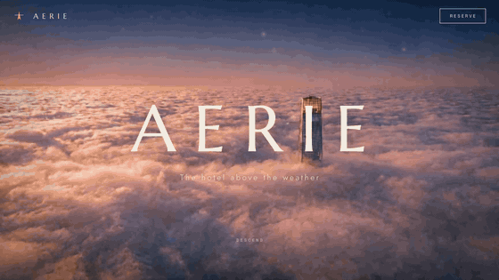

```
██████╗    ██████╗   ███████╗  ███████╗   █████╗   ██╗
██╔══██╗  ██╔═══██╗  ██╔════╝  ██╔════╝  ██╔══██╗  ██║
██████╔╝  ██║   ██║  █████╗    █████╗    ███████║  ██║
██╔══██╗  ██║   ██║  ██╔══╝    ██╔══╝    ██╔══██║  ██║
██║  ██║  ╚██████╔╝  ███████╗  ███████╗  ██║  ██║  ██║
╚═╝  ╚═╝   ╚═════╝   ╚══════╝  ╚══════╝  ╚═╝  ╚═╝  ╚═╝
```

# Scrolling Web Site with VidTSX

A [Claude Code](https://claude.com/claude-code) skill that turns "build me a
site" into a real interview, then a real, production-grade animated website in
TSX (React + TypeScript + Vite).

<!-- Hosted on the orphan `assets` branch, not in this tree, so installing the
     skill never pulls the demo animation down with it. -->


> Above: **AERIE**, a demo built with this skill. The whole page is one
> continuous cinematic shot - as you scroll, a live altimeter counts down the
> thousand-meter descent from the cloud-tops to the lobby, and the film scrubs
> frame-by-frame on a canvas.

It is a **process, not a template**. Claude runs a short structured interview,
pitches 2-3 named creative concepts, art-directs the world (palette, type,
motion, copy), and only then writes the site - from scratch, for that brand.
Every build ships with a responsive sweep and a measured verification pass
(screenshots, a jank test, an Open Graph card) before it's called done.

## What it builds

- **2D motion sites** - scroll-driven reveals, parallax, spring-physics
  entrances, kinetic type, seeded particle systems.
- **3D scenes** - react-three-fiber heroes or full-page 3D, with a real
  performance budget (instancing, mesh caps, 3-point lighting).
- **Scroll-film sites** - the page as one continuous cinematic shot, scrubbed
  by scroll (that's the AERIE demo above).
- **Landing pages that convert** - a written build spec before any code, one
  cinematic signature (a poster-first video hero, a spotlight lens, a depth
  carousel, a GLB product hero), and a screenshot score-and-fix loop that
  does not stop until the page averages 8/10 with nothing under 7.
- **Built for search and AI answers** - prerendered HTML that AI crawlers can
  read, answer-first passages, the right robots.txt for AI search crawlers,
  Core Web Vitals and agent readiness, all checked by the verify sweep.
- **Brand videos from the same world** - films, logo stings, explainers and
  social clips written as code and rendered frame-exact to MP4, no HyperFrames
  needed.

## What's inside

```
SKILL.md                          the process: interview, art-direct, build, verify, ship
references/tsx-motion-law.md      the build law (rAF + refs, seeded random, spring accents, 3D budget)
references/example-gallery.md     abstract idea menu with seed prompts
references/example-library.md     catalog of 26 real VidTSX compositions, with port math
references/motion-patterns.md     8 production-tested techniques, ready to port
references/perf-playbook.md       jank sources and fixes (rAF deltas, max < 50ms)
references/asset-pipeline.md      imagery sourcing, budgets, favicon + OG card checklist
references/rtl-hebrew.md          Hebrew/RTL: font pairings, bidi rules, mirrored motion
references/magicui.md             Magic UI: 75+ components by job, brand pairings, vanilla ports, LCP/CLS laws
references/kitchen.md             the Kitchen: 15 tactile components by job, tested vanilla recipes, license rule
references/kitchen-demo.html      every Kitchen recipe running live (open it in a browser)
references/opus-videos.md         code-to-video: the Opus 5.5 prompt library, brief template, render contract
references/video-starter.html     a 6s brand sting that implements the render contract
references/seo-schema.md          JSON-LD for local businesses (template + laws) and the SEO launch checklist
references/seo-geo.md             SEO, GEO (AI answers), Core Web Vitals and agent readiness to bake in while building
references/landing-craft.md       the build spec, taste rules with numbers, conversion anatomy, the score-and-fix loop
references/cinematic-techniques.md 11 signature recipes: video hero, spotlight lens, depth carousel, GLB hero, more
references/code-looks.md          looks in code: honest thermal false colour, halftone print, paper collage, boil
references/film-direction.md      directing a code film: carry, rhythm, reads timed for Hebrew, camera, shutter blur
scripts/verify.mjs                full sweep: 5 viewports, RTL-safe overflow, jank, screenshots, SEO/GEO, LCP/CLS, a11y tree
scripts/capture-og.mjs            real-hero OG card at 1200x630 with size budget
scripts/render-video.mjs          HTML animation to frame-exact MP4 (puppeteer + ffmpeg), with audio mux
```

## Example gallery

Not sure what you want? The skill can offer concrete starting points and build
from any of them. A curated catalog with seed prompts lives in
[`references/example-gallery.md`](references/example-gallery.md):

- **Logo & brand** - particle-converge reveal, glitch resolve, minimal fade
- **Social CTAs** - follow / subscribe / link-in-bio motion
- **Countdowns** - dramatic, New Year fireworks, launch 3-2-1
- **Educational** - loop visualization, Pythagorean proof, binary counter, fractions
- **Data & charts** - self-drawing bar / pie / line
- **Typography** - kinetic type, quote reveal, typewriter
- **Product reveals** - silhouette build, rotating shot, icon morph
- **Gaming & retro** - Game Over / CRT, 8-bit character, achievement unlock
- **Intros & outros** - channel intro, podcast wave, social outro
- **3D scenes** - nature (orbiting windmill), first-person POV coaster, landing-to-ad

More live TSX animation examples (2D and 3D) are at **https://vidtsx.com**.

### Motion library: real sources, real math

If you own VidTSX example files, drop the .tsx sources into one folder outside
any repo (e.g. `~/vidtsx-library/`) and tell Claude where they are. The catalog
in [`references/example-library.md`](references/example-library.md) indexes 26
compositions by filename - per-letter jump physics, packet-flow pipelines,
before/after sliders, spring preset palettes - with the frame-to-live
conversion rules for porting them into a site. Sources stay example-reference
only: never committed, never pasted verbatim. No sources? The same techniques
ship distilled in [`references/motion-patterns.md`](references/motion-patterns.md).

### Modern components: Magic UI

[Magic UI](https://magicui.design) ([source](https://github.com/magicuidesign/magicui),
MIT) adds a modern component vocabulary on top: border beams, animated beams
between elements, flickering grids, shiny and morphing text, marquees, globes,
device mockups. [`references/magicui.md`](references/magicui.md) catalogs every
component by job with brand pairings, decides when to install versus port
(SEO-critical pages port to vanilla CSS/TS so every word stays in static HTML),
and ships the vanilla ports and layout-shift lessons from a production page
that kept Lighthouse at 100 across the board with ten effects running.

### Tactile components: the Kitchen

[The Kitchen](https://www.dqnamo.com/kitchen) by dqnamo is a set of crafted
interaction studies: a pushable button, a perforated ticket, a postage stamp, a
receipt that prints, holographic foil, a card fan, hold-to-confirm, a signature
that draws itself. Where Magic UI adds light, these add material.
[`references/kitchen.md`](references/kitchen.md) catalogs all 15 by job and
brand mood and carries this skill's own vanilla recipes. They are rebuilt from
the techniques, because the Kitchen's source has no license.
[`references/kitchen-demo.html`](references/kitchen-demo.html) runs every recipe
live.

### Videos from code, not only HyperFrames

[awesome-opus5-5-videos](https://github.com/yihui-dev/awesome-opus5-5-videos)
collects 700+ prompts behind viral videos that Claude Opus 5.5 wrote as code.
[`references/opus-videos.md`](references/opus-videos.md) turns it into a
working path:
- Starting points by job.
- The prompt anatomy that makes them good.
- A brief template filled from the site's own art direction.
- A small render contract (`__duration`, `__seek(t)`, `__ready`).

`scripts/render-video.mjs` renders any page that implements the contract to a
frame-exact MP4, and
[`references/video-starter.html`](references/video-starter.html) is a working
example. The same composition can also run live on the site.

### Landing craft and cinematic techniques

[MotionSites Web Builder](https://github.com/Motionsites-AI/claude-skill)
showed that average AI pages come from a vague plan, no real media, and
nobody looking at the result. Its MIT-licensed method is adapted here:
[`references/landing-craft.md`](references/landing-craft.md) (the build spec,
taste rules with numbers, the score-and-fix rubric) and
[`references/cinematic-techniques.md`](references/cinematic-techniques.md)
(11 signature techniques, rewritten so the headline stays in the HTML, the
LCP stays fast and RTL mirrors). Its example prompts, media and paid tier are
not used: everything is free and self-hosted.

### Looks in code and film direction

[`references/code-looks.md`](references/code-looks.md) gives a page or film
one material look, drawn in code at no cost:
- thermal false colour that respects the physics (a damp patch reads cooler; only a hot
  line glows);
- halftone print with overprint;
- a paper collage that assembles from empty;
- line art that boils.

[`references/film-direction.md`](references/film-direction.md) makes a code
film read as one piece instead of a slideshow:
- something carried across every boundary;
- rhythm in numbers, and reads timed for the viewer (Hebrew included);
- an operated camera, transitions made of the medium;
- free shutter blur.

Adapted from the MIT parts of
[gbro-collage-broll](https://github.com/pyang5166/gbro-collage-broll),
[ClaudeAnimationBase](https://github.com/JohnHeibel/ClaudeAnimationBase) and
[lemo-opuscar](https://github.com/lemomo-ai/lemo-opuscar). Ideas from
[onetake](https://github.com/feitangyuan/onetake) are written from scratch, since it
is noncommercial.

### Search, AI answers and performance

[claude-seo](https://github.com/AgriciDaniel/claude-seo) (MIT) is distilled
into [`references/seo-geo.md`](references/seo-geo.md): what to build in so a
site ranks, gets cited by AI answers (Google AI Overviews, ChatGPT,
Perplexity, Claude) and passes Core Web Vitals, with every claim traced to its
source and the hype called out. `scripts/verify.mjs` checks it on every build:
- the raw HTML before JavaScript;
- robots.txt read the way crawlers read it, the sitemap and soft 404s;
- unnamed controls and covered tap targets;
- a throttled phone load with the LCP breakdown.

Only free tools. License notices are in
[`THIRD_PARTY_NOTICES.md`](THIRD_PARTY_NOTICES.md).

## Installation

Copy (or clone) this repository into your Claude Code skills directory:

```bash
git clone https://github.com/roeea2/scrolling-web-site-with-vidtsx.git \
  ~/.claude/skills/scrolling-web-site-with-vidtsx
```

Or, if you already have the skills folder cloned as a parent repo, drop this
directory in as-is - the only requirement is that `SKILL.md` sits at
`~/.claude/skills/scrolling-web-site-with-vidtsx/SKILL.md`. Restart Claude Code
(or start a new session) so it picks up the new skill.

No API keys, accounts, or extra dependencies are required to use the skill
itself. The sites it generates use plain Vite + React + TypeScript; Claude
installs those per-project as needed.

One optional setup, needed only for the scripts (`scripts/verify.mjs`,
`scripts/capture-og.mjs`, `scripts/render-video.mjs`). They use a local Chrome,
and video rendering also needs [ffmpeg](https://ffmpeg.org) on your PATH:

```bash
cd ~/.claude/skills/scrolling-web-site-with-vidtsx/scripts && npm install
```

## Usage

Just ask, in plain language, in any Claude Code session:

> "Build me an animated site in TSX for my coffee brand"
> "I want a scrolling website with 3D, interview me first"
> "Make a motion site like the vidtsx.com examples"
> "Build me a Hebrew site for my law firm" (full RTL, real Hebrew font pairing)
> "Make a 15-second launch video for the site we just built"
> "Use tactile Kitchen components for the booking flow"
> "Build a campaign landing page with a video hero for my clinic"

Claude will:

1. **Interview you** - what you're building, language and direction (English
   LTR / Hebrew RTL / bilingual), brand assets or full creative
   freedom, which motion language (2D / 3D / scroll-film), the top-to-bottom
   visitor journey, the sections after the hero, and where it should go live.
   Every question has a "you decide" option if you'd rather not choose, and it
   can offer concrete examples from the gallery or the local motion library if
   you're unsure.
2. **Pitch 2-3 named concepts** with a concrete walkthrough of what you'd
   actually see scrolling through each one, one marked as recommended.
3. **Art-direct the world** - exact palette, a real type pairing (with proven
   Hebrew pairings for RTL builds), a logo lockup, before writing any code.
4. **Build it** - a from-scratch TSX site following the motion and
   performance laws in [`references/tsx-motion-law.md`](references/tsx-motion-law.md),
   porting motion from the example library when a concept calls for it.
5. **Verify it** - `scripts/verify.mjs`: a responsive sweep across five
   viewports with zero horizontal overflow (both edges, RTL-safe), a measured
   jank test (p95/max frame time, not average FPS), fixed-chrome collision
   checks, and an accessibility floor - plus a real Open Graph share card
   captured from the finished hero.
6. **Ship it** - to your own Vercel account on request, only after a
   pre-publish exposure check.

You can invoke it explicitly too, by name, in any Claude Code session that has
the skill installed.

## Follow RoeeAI

Built and maintained by [RoeeAI](https://roeeaizman.com). New AI automation
guides and carousels, in Hebrew, every week:

- Instagram: [@roeeaiautomation](https://instagram.com/roeeaiautomation)
- YouTube: [@roeea2](https://www.youtube.com/@roeea2)
- Science channel: [@RoeeAIScience](https://www.youtube.com/@RoeeAIScience)
- HiTechPark channel: [@HiTechParkIL](https://www.youtube.com/@HiTechParkIL)
- Free guides: [roeeaizman.com/#guides](https://roeeaizman.com/#guides)

## License

MIT - see [LICENSE](LICENSE).
